<div align="center">



# ⚡ Awesome Workflow Orchestration 🚀

### *The definitive directory of SaaS platforms, open-source workflow engines, DAG schedulers, durable execution frameworks, and distributed pipeline runtimes.*

<p align="center">
  <a href="https://github.com/ishandutta2007/Awesome-Awesome-Awesome"></a><a href="https://discord.gg/jc4xtF58Ve"></a>
  <a href="https://github.com/ishandutta2007/Awesome-Workflow-Orchestration/stargazers"></a>
  <a href="https://github.com/ishandutta2007/Awesome-Workflow-Orchestration/network/members"></a>
  <a href="https://github.com/ishandutta2007/Awesome-Workflow-Orchestration/pulls"></a>
  <a href="https://github.com/ishandutta2007/Awesome-Workflow-Orchestration/blob/main/LICENSE"></a>
  <a href="https://github.com/ishandutta2007"></a>
</p>

</div>

---

## 📖 Overview & SEO Guide

**Workflow Orchestration** is the backbone of modern data infrastructure, distributed backend architectures, and machine learning platforms. These systems enable engineering teams to author, schedule, coordinate, retry, and monitor complex multi-step pipelines across heterogeneous cloud and on-premise environments.

Whether orchestrating enterprise **ETL/ELT batch pipelines**, **event-driven microservices**, **durable stateful code execution**, or **Kubernetes-native AI/ML training jobs**, choosing the right orchestration engine is critical for system resilience, operational cost efficiency, and developer velocity.

### 🔍 Key Technology Domains
- 🔄 **Data Asset & DAG Orchestration**: Scheduled and event-triggered DAGs managing data transformations, warehouses, and data lakes.
- 🛡️ **Durable Code Execution**: Fault-tolerant state machines providing automatic retries, timers, and saga compensation for distributed applications.
- ☸️ **Container-Native Orchestration**: Kubernetes CRD-driven workflow execution engines optimized for massive parallel task graphs and ML training runs.
- 🧬 **Scientific & Computational Pipelines**: Specialized workflow management systems for reproducible bioinformatics, HPC workloads, and deterministic processing.

---

## 📑 Table of Contents
- [📈 Sector Overview & Market Dynamics](#-sector-overview--market-dynamics)
- [☁️ SaaS & Hosted Platforms](#️-saas--hosted-platforms)
- [🐙 Open-Source GitHub Projects](#-open-source-github-projects)
- [🧭 Architectural Decision Matrix](#-architectural-decision-matrix)
- [🤝 How to Contribute](#-how-to-contribute)
- [💖 Support & Community](#-support--community)
- [⭐ Star History](#-star-history)
- [⚖️ Disclaimer](#️-disclaimer)

---

## 📈 Sector Overview & Market Dynamics

The global workflow orchestration and data pipeline management market is estimated at **$12.5 Billion in 2024** and is projected to expand to **$35.8 Billion by 2030**, growing at a sustained CAGR of **~19.2%**. This accelerated growth is propelled by enterprise data warehouse expansion, generative AI pipeline requirements, and distributed microservice complexity.

Rather than concentrating into a winner-take-all monopoly, the sector exhibits **moderate to high fragmentation**. Public cloud hyper-scalers (*Microsoft Azure, AWS, Google Cloud*) anchor native infrastructure glue and event routing, while specialized open-core software ecosystems (*Astronomer/Airflow, Dagster Labs, Prefect, Temporal Technologies*) dominate code-first developer experience, hybrid multi-cloud portability, and mission-critical durable execution.

---

## ☁️ SaaS & Hosted Platforms

Below is a breakdown of prominent managed workflow orchestration services, sorted descending by corporate scale and valuation.

| 🏢 Platform / Service | 📊 Company Scale (Valuation / Revenue) | 💳 Starting Tier Pricing | 🎁 Free Tier / Trial Limits | 🛠️ Core Strengths & Primary Focus |
| :--- | :--- | :--- | :--- | :--- |
| [**Azure Data Factory**](https://azure.microsoft.com/services/data-factory/) | **Microsoft**<br>~$3.1 Trillion Market Cap<br>*(~$245B+ Annual Revenue)* | **$1.00** per 1,000 activity runs + data movement from **$0.25**/DIU-hr (*$0.005/hr for self-hosted IR*) | **30-Day Free Trial** with **$200** credits + ongoing free allowance of **5 low-frequency activities/month** | Enterprise ETL/ELT pipelines, 90+ native SaaS/database connectors, SSIS package execution, and hybrid cloud integration. |
| [**AWS Step Functions**](https://aws.amazon.com/step-functions/) | **Amazon AWS**<br>~$2.2 Trillion Market Cap<br>*(~$105B+ AWS Run-Rate)* | **$0.025** per 1,000 state transitions for Standard; **$1.00** per 1M requests + **$0.00001667**/GB-sec for Express | **4,000 free state transitions** per month forever under the permanent AWS Free Tier | Serverless visual state machine orchestration, low-latency microservices workflows, distributed saga pattern management. |
| [**Amazon MWAA**](https://aws.amazon.com/managed-workflows-for-apache-airflow/) | **Amazon AWS**<br>~$2.2 Trillion Market Cap<br>*(~$105B+ AWS Run-Rate)* | **$0.49**/hour (~**$353**/month base for Small environment) + **$0.055**/worker-hour for auto-scaling workers | **30-Day Free Trial** via AWS promotional credit program (**$300** credit for eligible new cloud accounts) | Managed Apache Airflow with native AWS IAM authentication, automated KMS encryption, VPC isolation, and auto-scaling. |
| [**Google Cloud Composer**](https://cloud.google.com/composer) | **Alphabet / Google**<br>~$2.1 Trillion Market Cap<br>*(~$40B+ GCP Run-Rate)* | **$0.35**/hour (~**$250**/month base commit for Composer 2 Small environment including scheduler, web server, and worker resources) | **90-Day Free Trial** with **$300** credits valid across Google Cloud Platform | Fully managed Apache Airflow built on GKE with seamless BigQuery, Vertex AI, Cloud Storage integrations, and auto-repairing nodes. |
| [**Temporal Cloud**](https://temporal.io/cloud) | **Temporal Technologies**<br>~$1.5 Billion Valuation<br>*(~$100M+ Series B raised)* | **$25**/month base namespace fee + **$0.000042** per Action (*$42 per 1M actions*) + **$0.0042** per Active Storage GB-month | **30-Day Free Trial** with **$1,000** in complimentary service credits provided upon namespace creation | Code-as-workflows durable execution, guaranteed state persistence, automatic compensation, and zero queue-configuration overhead. |
| [**Astronomer (Astro)**](https://www.astronomer.io/) | **Astronomer Inc.**<br>~$1.2 Billion Valuation<br>*(~$283M+ Total Funding)* | **$0.35** per Astro Unit (AU) hour (~**$250**/month minimum commit for Standard production deployment cluster) | **14-Day Free Trial** with **$300** in cloud deployment execution credits *(no credit card required)* | Enterprise control plane for Apache Airflow, DAG CI/CD pipelines, ephemeral preview deployments, and OpenLineage governance. |
| [**Prefect Cloud**](https://www.prefect.io/pricing) | **Prefect Technologies**<br>~$250 Million Valuation<br>*(~$32M+ Series B raised)* | **$39**/month (Pro tier includes 3 user seats and 100,000 flow runs/month; **$0.0005** per additional flow run) | **Free Forever Plan**: 1 user seat, 1 workspace, **20,000 flow runs/month**, and 30-day run history retention | Modern Python-native dynamic flows, hybrid execution model keeping data in your VPC, event-driven webhooks, and sub-second dispatch. |
| [**Dagster+ (Dagster Cloud)**](https://dagster.io/pricing) | **Dagster Labs**<br>~$175 Million Valuation<br>*(~$48M+ Series B raised)* | **$100**/month (Serverless Pro Starter with $100 monthly credit consumption commit) or **$1,000**/year base Hybrid | **30-Day Free Trial** of Pro with **$100 credit** + **Free Starter Plan**: 1 user seat and **2,500 compute credits/month** | Software-defined asset (SDA) orchestration, declarative partition management, end-to-end data lineage, and branch environments. |
| [**Union.ai (Union Cloud)**](https://www.union.ai/pricing) | **Union.ai**<br>~$100 Million Valuation<br>*(~$19.1M Series A raised)* | **$150**/month base platform management fee + underlying cloud infrastructure pass-through compute costs | **14-Day Free Trial** with full enterprise feature suite and **$100** serverless infrastructure execution credits | Hosted enterprise Flyte for mission-critical machine learning workflows, distributed GPU training jobs, and typed data pipelines. |
| [**Kestra Cloud**](https://kestra.io/pricing) | **Kestra Technologies**<br>~$45 Million Valuation<br>*(~$8M+ Seed/Series A)* | **$199**/month (Team Tier includes 5 user seats and unlimited workflow executions via hybrid cloud workers) | **14-Day Free Trial** of Enterprise Cloud with up to **5,000 task executions** + **Free Forever** Community Edition | Declarative YAML-first workflow orchestration, real-time event-driven triggers, microservices coordination, and in-browser code editor. |

---

## 🐙 Open-Source GitHub Projects

The open-source workflow ecosystem provides complete infrastructure ownership, local developer testability, and freedom from vendor lock-in. Below are the leading open-source repositories, **sorted descending by GitHub star count**.

### 1. [Apache Airflow](https://github.com/apache/airflow) [](https://github.com/apache/airflow/stargazers)
- **Primary Language**: Python | **License**: Apache-2.0
- **Summary**: The industry standard for data engineering pipelines. Define workflows as Directed Acyclic Graphs (DAGs) in Python. Features hundreds of ecosystem providers (Snowflake, AWS, GCP, Databricks), dynamic pipeline generation, rich monitoring web UI, and scalable Celery/Kubernetes executors.

### 2. [Conductor](https://github.com/conductor-oss/conductor) [](https://github.com/conductor-oss/conductor/stargazers)
- **Primary Language**: Java | **License**: Apache-2.0
- **Summary**: Battle-tested, event-driven orchestration engine created at Netflix. Coordinates microservices, human tasks, and agentic AI flows across polyglot applications with high throughput, latency SLAs, and visual state tracking.

### 3. [Kestra](https://github.com/kestra-io/kestra) [](https://github.com/kestra-io/kestra/stargazers)
- **Primary Language**: Java / Kotlin | **License**: Apache-2.0
- **Summary**: Infinitely scalable, event-driven declarative orchestrator. Define workflows using clean YAML, integrate with 600+ built-in plugins, execute scripts in Python, Shell, Node, or Docker, and monitor executions in real-time.

### 4. [Prefect](https://github.com/PrefectHQ/prefect) [](https://github.com/PrefectHQ/prefect/stargazers)
- **Primary Language**: Python | **License**: Apache-2.0
- **Summary**: High-performance Pythonic coordination system. Turn ordinary Python functions into production-ready pipelines using `@task` and `@flow` decorators. Features automatic retries, concurrency controls, background worker pools, and dynamic task mapping.

### 5. [Temporal](https://github.com/temporalio/temporal) [](https://github.com/temporalio/temporal/stargazers)
- **Primary Language**: Go / Polyglot SDKs | **License**: MIT
- **Summary**: Groundbreaking durable execution platform. Eliminates asynchronous failure handling complexity by making distributed code resilient to process crashes, network partitions, and host reboots with automatic state recovery.

### 6. [Luigi](https://github.com/spotify/luigi) [](https://github.com/spotify/luigi/stargazers)
- **Primary Language**: Python | **License**: Apache-2.0
- **Summary**: Spotify's pioneer pipeline framework. Solves dependency resolution and target idempotence for long-running batch processes, Hadoop jobs, Spark clusters, and database ETL tasks.

### 7. [Windmill](https://github.com/windmill-labs/windmill) [](https://github.com/windmill-labs/windmill/stargazers)
- **Primary Language**: Rust / TypeScript | **License**: AGPL-3.0 / Apache-2.0
- **Summary**: Ultra-fast developer platform alternative to Airplane and Retool. Turn Python, TypeScript, Go, and Bash scripts into reliable scheduled workflows, event-driven webhooks, and auto-generated internal apps.

### 8. [Argo Workflows](https://github.com/argoproj/argo-workflows) [](https://github.com/argoproj/argo-workflows/stargazers)
- **Primary Language**: Go | **License**: Apache-2.0
- **Summary**: CNCF graduated container-native workflow engine for Kubernetes. Implemented as Kubernetes Custom Resource Definitions (CRDs) where each task executes in its own isolated pod, powering large-scale parallel processing.

### 9. [Dagster](https://github.com/dagster-io/dagster) [](https://github.com/dagster-io/dagster/stargazers)
- **Primary Language**: Python | **License**: Apache-2.0
- **Summary**: Modern orchestrator organized around Software-Defined Assets (SDAs). Tracks data lineage, schema changes, and upstream freshness declarations rather than just task execution order.

### 10. [Apache DolphinScheduler](https://github.com/apache/dolphinscheduler) [](https://github.com/apache/dolphinscheduler/stargazers)
- **Primary Language**: Java | **License**: Apache-2.0
- **Summary**: Distributed, visual big data workflow scheduler. Supports drag-and-drop DAG assembly, multi-tenant cluster management, and integration with Flink, Spark, Hive, ClickHouse, and Presto.

### 11. [Metaflow](https://github.com/Netflix/metaflow) [](https://github.com/Netflix/metaflow/stargazers)
- **Primary Language**: Python | **License**: Apache-2.0
- **Summary**: Netflix-originated, human-centric framework designed for machine learning and data science. Write code locally in pure Python and seamlessly offload steps to AWS Batch, Kubernetes, or GCP compute.

### 12. [Cadence](https://github.com/cadence-workflow/cadence) [](https://github.com/cadence-workflow/cadence/stargazers)
- **Primary Language**: Go / Java | **License**: Apache-2.0
- **Summary**: Uber's distributed orchestration engine that served as the architectural predecessor to Temporal. Preserves state across prolonged asynchronous operations and guarantees fault-tolerant task dispatch.

### 13. [Tekton Pipelines](https://github.com/tektoncd/pipeline) [](https://github.com/tektoncd/pipeline/stargazers)
- **Primary Language**: Go | **License**: Apache-2.0
- **Summary**: Standardized, cloud-native pipeline foundation under the Continuous Delivery Foundation (CDF). Models Tasks and Pipelines as native Kubernetes resources for automated builds, tests, and multi-cloud workflows.

### 14. [Mage](https://github.com/mage-ai/mage-ai) [](https://github.com/mage-ai/mage-ai/stargazers)
- **Primary Language**: Python | **License**: Apache-2.0
- **Summary**: Modern open-source data pipeline tool emphasizing developer UX. Combines notebook-style interactive development with SQL and Python blocks, integrated version control, and data validation testing.

### 15. [Flyte](https://github.com/flyteorg/flyte) [](https://github.com/flyteorg/flyte/stargazers)
- **Primary Language**: Go / Python | **License**: Apache-2.0
- **Summary**: Production-grade, Kubernetes-native workflow engine with compile-time type safety. Ideal for massive AI/ML workflows, GPU-intensive model training, reproducible data transformations, and distributed processing.

### 16. [Kubeflow Pipelines](https://github.com/kubeflow/pipelines) [](https://github.com/kubeflow/pipelines/stargazers)
- **Primary Language**: Python / Go | **License**: Apache-2.0
- **Summary**: Platform for building and deploying reproducible end-to-end machine learning workflows on Kubernetes. Provides tracking of experiments, pipeline versioning, and execution artifact lineage.

### 17. [Nextflow](https://github.com/nextflow-io/nextflow) [](https://github.com/nextflow-io/nextflow/stargazers)
- **Primary Language**: Groovy / Java | **License**: Apache-2.0
- **Summary**: Reactive computational workflow system specifically designed for data-intensive scientific pipelines, genomic analysis, and containerized computation across HPC clusters and cloud batch services.

### 18. [Snakemake](https://github.com/snakemake/snakemake) [](https://github.com/snakemake/snakemake/stargazers)
- **Primary Language**: Python | **License**: MIT
- **Summary**: Declarative, rule-based workflow engine built on Python. Universally adopted across bioinformatics, astronomy, and data science for creating deterministic, transparent, and reproducible analytical pipelines.

---

## 🧭 Architectural Decision Matrix

Choosing the right workflow orchestrator depends on your team's specific requirements, deployment model, and execution primitives:

```
                                  What is your primary workload?
                                                │
         ┌──────────────────────────────┬───────┴──────────────────────┬──────────────────────────────┐
         ▼                              ▼                              ▼                              ▼
  [Data Asset / ETL]           [Microservices / Sagas]        [Containers / K8s]             [Scientific / HPC]
         │                              │                              │                              │
 ┌───────┴───────┐              ┌───────┴───────┐              ┌───────┴───────┐              ┌───────┴───────┐
 ▼               ▼              ▼               ▼              ▼               ▼              ▼               ▼
Airflow       Dagster        Temporal       Conductor        Argo           Flyte         Nextflow       Snakemake
(Industry     (Asset-        (Code-as-      (Event-         (CRD-native    (Type-safe     (Genomics/     (Rule-based
 standard)     centric)       workflows)     driven)         pods)          MLOps)         HPC batch)     reproducible)
```

| Use Case Scenario | Top Recommendation | Alternative Options | Why This Choice? |
| :--- | :--- | :--- | :--- |
| **Enterprise Data Engineering** | **Apache Airflow** | Dagster, Astronomer | Ubiquitous ecosystem plugins, universal hiring pool, and mature managed cloud offerings. |
| **Asset-Centric Data Platform** | **Dagster** | Prefect, Mage | Software-Defined Assets track data freshness, partition slices, and column lineage natively. |
| **Pythonic Dynamic Pipelines** | **Prefect** | Mage, Windmill | Pure Python function decorators, dynamic task graphs, and hybrid VPC execution model. |
| **Distributed Microservice Sagas** | **Temporal** | Conductor, Cadence | Eliminates queue and state-machine boilerplate with deterministic durable execution. |
| **Cloud-Native / Kubernetes Batch** | **Argo Workflows** | Tekton, Flyte | Direct Kubernetes CRDs, pod-level container isolation, and massive parallel scaling. |
| **Production AI/ML Pipelines** | **Flyte** | Kubeflow, Metaflow | Compile-time typing, fine-grained GPU resource allocation, and reproducible container caching. |
| **Bioinformatics & Scientific Analysis** | **Nextflow** | Snakemake | Native integration with HPC job schedulers (SLURM, PBS), Singularity/Docker, and Conda. |

---

## 🤝 How to Contribute

Contributions are welcome and deeply appreciated! Help keep this guide accurate, fresh, and comprehensive:

1. 🍴 **Fork the repository** on GitHub.
2. 🌿 **Create a descriptive feature branch** (`git checkout -b add-my-orchestration-tool`).
3. 📝 **Update or add entries** following the established format:
   - For SaaS: Name, link, company size/valuation, exact starting price, free tier/trial limit, and key strengths.
   - For Open-Source: Name, GitHub repository link, star badge (`style=social&color=white` linking to stargazers), language, license, and concise summary.
4. 🧪 **Ensure all links are working and Markdown renders cleanly.**
5. 🚀 **Submit a Pull Request** with a brief summary of additions or updates.

---

## 💖 Support & Community

Thank you for exploring **Awesome Workflow Orchestration**! If you find this curated directory valuable for your engineering architecture, platform stack, or pipeline design:

- ⭐ **Star this repository** to improve discoverability for other engineers!
- 🍴 **Fork and share** with colleagues, data engineering communities, and platform teams.
- 💬 **Join our Discord** at [discord.gg/jc4xtF58Ve](https://discord.gg/jc4xtF58Ve) to discuss orchestration trends and best practices.
- ☕ **Sponsor the Project**: Support ongoing maintenance, ecosystem research, and updates by buying a coffee via the [GitHub Sponsor Dashboard](https://github.com/sponsors/ishandutta2007).

---

## ⭐ Star History

[](https://star-history.dera.page/#ishandutta2007/Awesome-Workflow-Orchestration&type=date&legend=top-left)

---

## ⚖️ Disclaimer

- This repository is a **community-curated index** intended for architectural evaluation, educational benchmarking, and research.
- Product names, logos, and brands belong to their respective copyright holders.
- Pricing, free tier limits, and corporate valuations change over time; refer to official platform websites for current commercial terms.
- Workflow orchestration engines process credentials and orchestrate production data mutations. Always implement least-privilege RBAC, secret managers, and idempotent execution semantics.

---

<div align="center">
  <b>Built with ❤️ for data engineers, platform architects, and distributed systems builders worldwide.</b>
</div>
